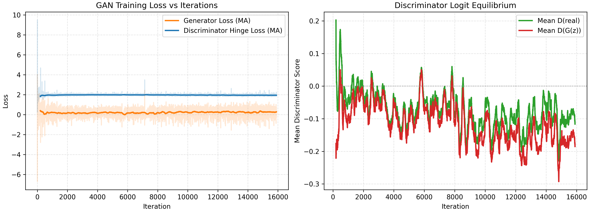
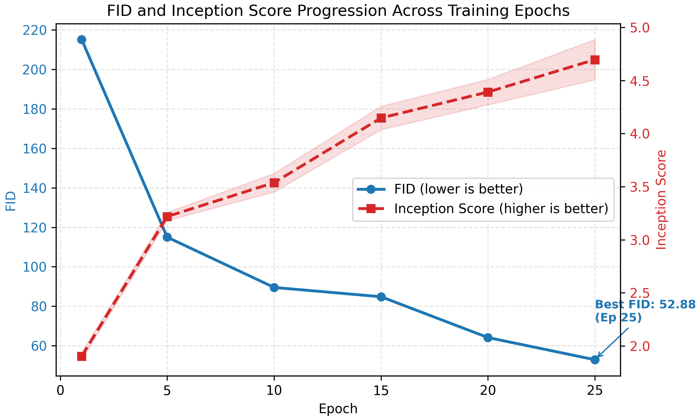
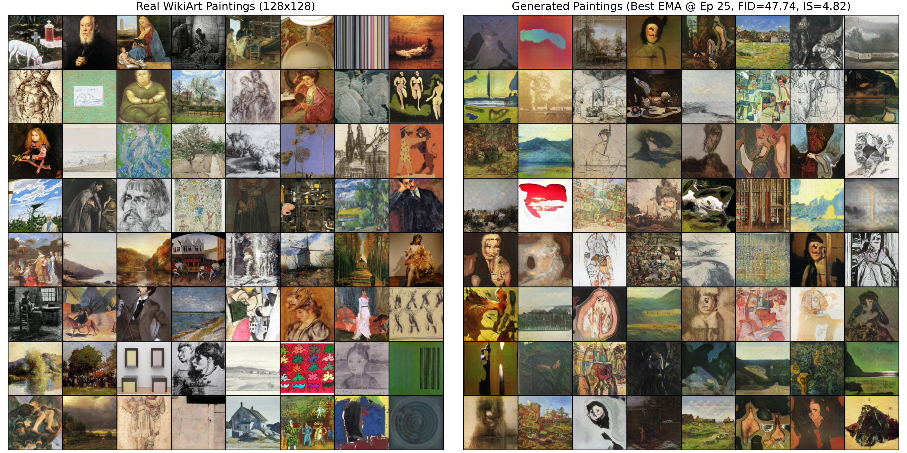
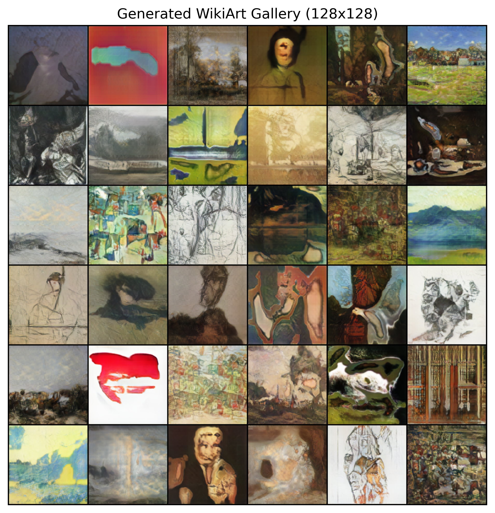
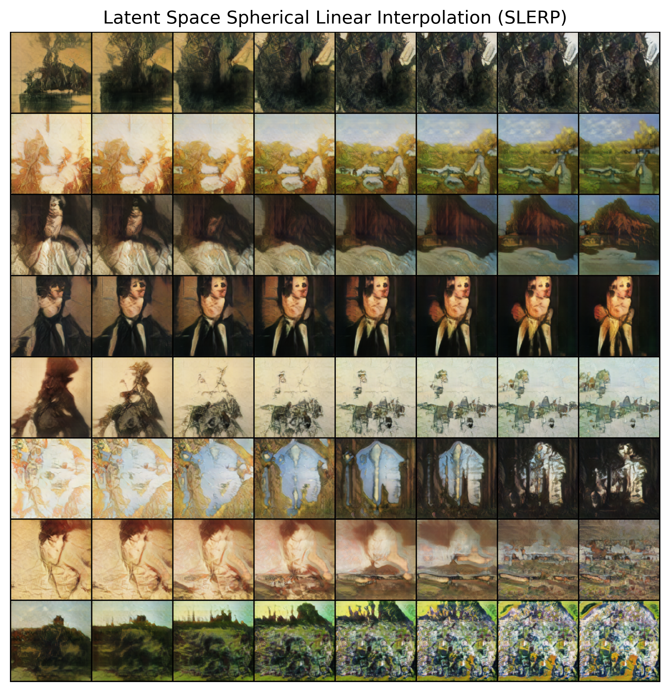

# ECE 285 HW02 — WikiArt Painting Generation with Self-Attention SNGAN-ResNet

An unconditional Generative Adversarial Network (**Self-Attention SNGAN-ResNet**) trained on the full **WikiArt** painting dataset (**81,444** paintings across **27** art styles) at `128×128` resolution, with PyTorch-Ignite-compatible **FID** and **Inception Score (IS)** evaluation.

---

## Key Features & Engineering Optimizations

- **Architecture (`Self-Attention SNGAN-ResNet`)**:
  - **Generator (`5.82M` params)**: `ResBlockUp` using `Nearest Upsample + Conv3x3` (eliminating transposed-convolution checkerboard artifacts), `BatchNorm2d`, `SiLU`, and a `32×32` `SDPA Self-Attention` layer for global compositional coherence.
  - **Discriminator (`3.53M` params)**: Spectral-normalized `ResBlockDown` blocks without BatchNorm, skipping pre-activation on the first RGB input block to preserve dark tones, a `32×32` `Self-Attention` layer, and Global Sum Pooling.
  - **Training Stability**: Hinge adversarial loss, Two Time-Scale Update Rule (**TTUR**, `lr_G=1e-4`, `lr_D=2e-4`, `betas=(0.0, 0.999)`), symmetric **DiffAugment** (`color,translation`), and **EMA** (`decay=0.999` with warmup and BatchNorm buffer synchronization).
- **Hardware & Runtime Efficiency (NVIDIA RTX 5070 Ti, 15.89 GB VRAM)**:
  - **One-time Multithreaded Memmap Cache**: WikiArt originals average `1382×1492` px (up to `15754×17768` px). A 16-worker preprocessing pass resizes and center-crops all 81,444 images once into a contiguous `uint8` `numpy.memmap`, eliminating per-epoch JPEG decoding overhead and Windows `DataLoader` multiprocessing issues.
  - **BF16 Mixed Precision & Graph Reuse**: Uses `torch.amp.autocast("cuda", dtype=torch.bfloat16)`, `channels_last` memory format, and reuses the generator forward graph `fake` between $D$ and $G$ updates (~33% compute reduction).
  - **Resource Usage**: **5.65 GB peak VRAM**, **~113 s/epoch** (636 steps/epoch at batch size 128).
- **FID & Inception Score Evaluation**:
  - Follows the [PyTorch-Ignite GAN Evaluation blog](https://pytorch-ignite.ai/blog/gan-evaluation-with-fid-and-is/) (`Inception-v3` resized to `299×299` via antialias bilinear interpolation).
  - Fixes the blog's `[-1, 1]`-to-`[0, 1]` range clamping and ImageNet normalization, caches real dataset Inception statistics once, and provides a zero-extra-dependency GPU evaluator (`PyTorch + SciPy`) alongside an optional native `pytorch-ignite` Engine backend.
  - Real reference images are **uniformly sampled across all 27 art styles** (`seed=42`) rather than slicing the first alphabetical folder.

---

## Quantitative Results

### Hyperparameter Settings

| Hyperparameter | Value |
| :--- | :--- |
| Model | Self-Attention SNGAN-ResNet (`128×128`) |
| Latent Dimension (`z_dim`) | `128` |
| Generator / Discriminator Params | `5.816M` / `3.534M` |
| Batch Size | `128` (636 steps/epoch) |
| Epochs | `25` (15,900 total iterations) |
| Optimizers (TTUR) | Adam, `lr_G = 1e-4`, `lr_D = 2e-4`, `betas = (0.0, 0.999)` |
| Loss Function | Hinge Loss |
| DiffAugment Policy | `color,translation` |
| EMA Decay | `0.999` (with warmup) |
| Precision / Memory Layout | `bfloat16` AMP + `channels_last` |
| Peak VRAM | `5.651 GB` (RTX 5070 Ti) |

### Progression Across Epochs (5,000 Generated Samples)

| Epoch | Loss D | Loss G | FID ↓ | Inception Score ↑ |
| :---: | :---: | :---: | :---: | :---: |
| 1 | `1.9126` | `0.2364` | `215.16` | `1.903 ± 0.033` |
| 5 | `1.9810` | `0.1574` | `114.99` | `3.219 ± 0.038` |
| 10 | `1.9809` | `0.1665` | `89.51` | `3.538 ± 0.088` |
| 15 | `1.9700` | `0.2354` | `84.80` | `4.148 ± 0.110` |
| 20 | `1.9540` | `0.3014` | `64.11` | `4.392 ± 0.120` |
| **25** | `1.9434` | `0.2683` | **`52.88`** | **`4.697 ± 0.189`** |

### Final Evaluation on Best EMA Checkpoint (10,000 Samples, Uniform 27-Style Reference)

| Metric | Value |
| :--- | :--- |
| Best Checkpoint Epoch | `25` |
| **Final FID (10k)** ↓ | **`47.7444`** |
| **Final Inception Score (10k)** ↑ | **`4.8169 ± 0.1177`** |
| Real WikiArt Inception Score (10k reference) | `8.6494 ± 0.1282` |

---

## Visual Results

### Training Loss & Discriminator Equilibrium


### FID & Inception Score Progression


### Real WikiArt vs. Best EMA Generated Paintings (`128×128`)


### Generated Paintings Gallery (`6×6`)


### Latent Space Spherical Linear Interpolation (`SLERP`)


---

## Repository Structure

```text
ece285-hw02/
├── wikiart_gan.py               # Consolidated training, evaluation & plotting script
├── requirements.txt             # Python dependencies
├── README.md
└── outputs/
    ├── config.json              # Hyperparameter configuration
    ├── history.json             # Per-iteration & per-epoch metrics history
    ├── metrics_summary.json     # Final 10k evaluation summary
    ├── checkpoints/
    │   └── best_checkpoint.pt   # Best EMA generator checkpoint (Epoch 25)
    ├── figures/                 # High-DPI figures for the report
    └── samples/                 # Fixed-noise progression grids (Epoch 1 -> 25)
```

---

## Quick Start

### 1. Environment Setup

```bash
pip install -r requirements.txt
```

*(Install PyTorch with CUDA support matching your GPU driver; tested on Python 3.13 + PyTorch 2.10.0+cu130.)*

### 2. Generate Paintings from the Included Checkpoint (No Dataset Required)

```bash
python wikiart_gan.py --sample-only
```

This loads `outputs/checkpoints/best_checkpoint.pt` and regenerates `generated_gallery.png` and `latent_interpolation.png` (plus loss/FID/IS plots from `outputs/history.json`).

### 3. Full Training & Evaluation from Scratch

1. Download the [WikiArt dataset](https://www.kaggle.com/datasets/steubk/wikiart) and extract the 27 style folders into `./data/`.
2. Run the full pipeline:

```bash
python wikiart_gan.py
```

Useful options:
- `python wikiart_gan.py --eval-only`: Run 10k FID/IS evaluation and export all figures using `best_checkpoint.pt`.
- `python wikiart_gan.py --image-size 64 --epochs 25`: Fast `64×64` baseline configuration.
- `python wikiart_gan.py --eval-backend ignite`: Use native `pytorch-ignite` `FID` and `InceptionScore` metrics (requires `pip install pytorch-ignite`).
